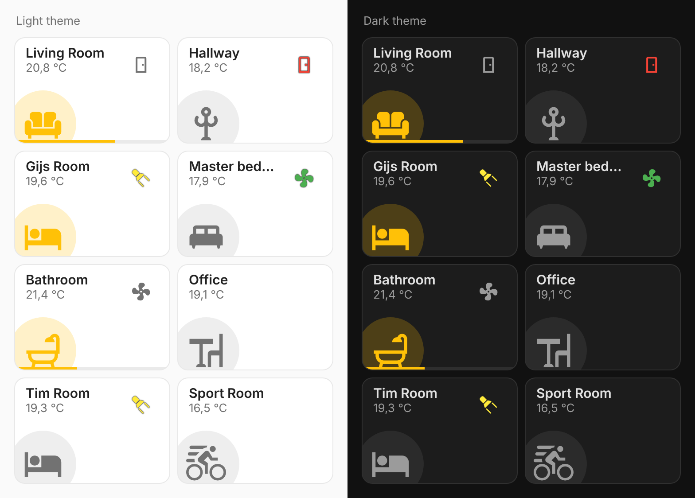

# Room Card

A fast, lightweight room tile for Home Assistant sections views. One JavaScript file, no build step, no dependencies, no card_mod, no Jinja.



- **Top left:** room name and temperature (1 decimal, your locale).
- **Bottom left:** a big round button for the main light. Coloured when on, grey when off. Optional brightness bar or % for dimmable lights.
- **Right:** up to 3 small round chips. Each is a toggle (switch, light, fan, input_boolean, scene, script) or status only (e.g. a door contact).
- **Instant feedback:** a tap shows the new state right away, then HA confirms it. If the device does not follow within 5 s, or the call fails, the button rolls back with a red ring and a short shake.
- **Tap** toggles, **hold** (500 ms) opens more-info. Ripple, haptics in the companion app, `prefers-reduced-motion` respected.
- Only re-renders when one of its own entities changes.
- Unavailable or missing entities are dimmed with a red badge.

## Install

HACS > three dots > Custom repositories > add `https://github.com/BarBaar44/room-card`, type **Dashboard**. Install, then reload the browser.

Needs HA 2024.11 or newer (`getGridOptions`).

## Use

```yaml
type: custom:room-card
name: Gijs Room
temperature: sensor.temperature_room_gijs_temperature
main:
  entity: switch.shelly1_gijs_shelly1_shelly1_gijs
  icon: mdi:bed
chips:
  - entity: switch.sonoff_gijs_sonoff_gijs
    icon: mdi:spotlight-beam
    color: yellow
  - entity: binary_sensor.front_door_sensor_contact
    icon: mdi:door
    color: red
    tap: none
```

At least one of `temperature`, `main` or `chips` is required. A full example for 8 rooms is in [rooms.yaml](rooms.yaml).

### Card options

| Option        | Default                                      |
| ------------- | -------------------------------------------- |
| `name`        | friendly name of the temperature sensor      |
| `temperature` | none                                         |
| `main`        | none (no big button)                         |
| `chips`       | none, at most 3                              |
| `colors`      | none, see Colours                            |

### `main` and chip options

| Option       | Default                                                                                   |
| ------------ | ----------------------------------------------------------------------------------------- |
| `entity`     | none. `main` without entity is a static icon                                              |
| `icon`       | entity icon, else a domain icon                                                           |
| `color`      | `amber`. A theme name (`red`, `green`, `blue`, `yellow`, ...), any CSS colour, or `auto` (light's own `rgb_color`) |
| `tap`        | `toggle` for toggle domains, else `none`. Also `more-info`                                |
| `hold`       | `more-info` when tap is not `none`, else `none`                                           |
| `brightness` | `main` only: `bar`, `percent` or `none`. Default `bar`, shown for dimmable lights that are on |

Typos in option names show an error card instead of being ignored.

### Colours

Every colour can be set per card with `colors`, or for all cards from a theme with the matching CSS variable. Values: a theme name (`red`, `amber`, ...) or any CSS colour.

```yaml
colors:
  name: white
  icon_off: "#8a8a8a"
  chip_outline: transparent
```

| `colors` key      | Theme variable                  | Default                                  |
| ----------------- | ------------------------------- | ---------------------------------------- |
| `name`            | `--room-card-name-color`        | `--primary-text-color`                   |
| `temperature`     | `--room-card-temperature-color` | `--secondary-text-color`                 |
| `icon_off`        | `--room-card-off-color`         | `--secondary-text-color`                 |
| `background_off`  | `--room-card-off-background`    | light tint of the text colour            |
| `background_on`   | `--room-card-on-background`     | light tint of the button's `color`       |
| `chip_icon_off`   | `--room-card-chip-off-color`    | same as `icon_off`                       |
| `chip_background` | `--room-card-chip-background`   | `transparent`                            |
| `chip_outline`    | `--room-card-chip-outline`      | `rgba(0,0,0,0.75)`, light mode only      |
| `badge`           | `--room-card-badge-color`       | `--error-color`                          |
| `badge_icon`      | `--room-card-badge-icon-color`  | `#fff`                                   |
| `bar`             | `--room-card-bar-color`         | the main button's `color`                |
| `bar_background`  | `--room-card-bar-background`    | light tint of the text colour            |
| `ripple`          | `--room-card-ripple-color`      | the icon colour                          |
| `focus`           | `--room-card-focus-color`       | `--primary-color`                        |
| `failure`         | `--room-card-failure-color`     | `--error-color`                          |
| `card_background` | `--ha-card-background`          | theme                                    |
| `card_border`     | `--ha-card-border-color`        | theme                                    |

The "on" colour of each button is its own `color` option.

### Sizes

Theme variables:

| Variable                      | Default      |
| ----------------------------- | ------------ |
| `--room-card-icon-size`       | `75px`       |
| `--room-card-icon-inner-size` | `45px`       |
| `--room-card-icon-offset-x`   | `-6px`       |
| `--room-card-icon-offset-y`   | `-16px`      |
| `--room-card-chip-size`       | `44px`       |
| `--room-card-chip-align`      | `flex-start` (try `center`) |

## Sizing

Default is 6 columns by 2 rows. The main circle is anchored in the bottom left corner and runs off the card edge, so it stays 75px at any height. Chips shrink to fit when there are 3.

## Why it's fast

- Tap goes straight to `homeassistant.turn_on`/`turn_off` and the colour changes before HA answers. No template sensor in between.
- The DOM is built once per config and updated in place.
- To get the page load benefit, remove `card-mod`, mushroom and `stack-in-card` from your resources once no other card on the dashboard needs them.

## Roadmap

A `custom:device-button` card in the same file for big device buttons (espresso machine, dishwasher, ...), on the same base: optimistic tap, state read in JS, active border and CSS icon animations. A visual editor later.

## Development

The card needs nothing to run. Tests use jsdom:

```sh
npm install
npm test
```

A release is made by bumping `VERSION` in `room-card.js`, committing, and pushing a matching tag (`v0.1.1`). The Release workflow checks the tag against `VERSION`, runs the tests and publishes the GitHub release that HACS picks up.

## Licence

MIT
