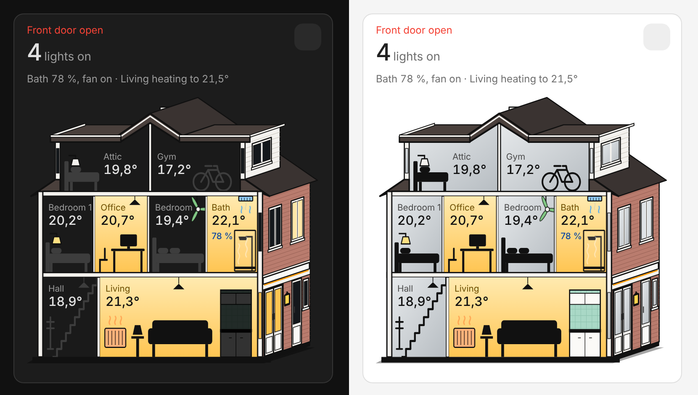

# Room Card

The whole house in one Home Assistant dashboard card. Instead of a tile per room, it draws the house as a cut-away line drawing, in the style of the [Tesla Model 3](https://github.com/BarBaar44/tesla-model3-card) and [Gardenview House](https://github.com/BarBaar44/gardenview-house) cards: every room in its place, lit rooms glowing, the garden side of the house next to it.



One JavaScript file, no build step, no dependencies, no card_mod, no Jinja. It replaces the eight v0.2 room tiles on the Home view.

The drawing is the owner's own house: attic with a dakkapel on both sides (Tim, Sport Room), first floor (Gijs, Office, Master bedroom, Bathroom), ground floor (Hallway with the stairs, Living Room with the open kitchen behind it). Every entity can be changed or switched off; the rooms themselves stay where the drawing puts them.

## What it shows

| Part | Shows |
|---|---|
| Name row | The card name, or the first warning: `Front door open`, `Garden doors open`, `Kitchen door open`, `Living window open` (red), then `Gijs light unavailable` (amber). `+2` when there are more |
| Big number | How many room lights and bed lights are on, or `All off` |
| Status line | Only what matters now: `Shower running`, `Bath 78 %, fan on` (humidity at or above `humidity_alert`), `Living heating to 21,5°` (or `Heating Living, Gijs`). With nothing going on: the average inside temperature |
| Rooms | Short name and temperature (1 decimal, your locale). A lit room glows amber; a dark room is black glass at night and silver by day. An unavailable light dims its room |
| Bedrooms | Gijs and Tim: a bed light by the headboard that turns yellow when on. Master: a ceiling fan that spins when on |
| Bathroom | Shower cabin with running water while the shower is on; steam and the humidity in blue at or above `humidity_alert` or while showering; air rising into the ceiling extractor while the fan runs |
| Living Room | Radiator that glows with heat waves while its thermostat is heating; open passage to the kitchen |
| Kitchen | Lit by day; at night dark, or warm while `kitchen_light` is on. Its door and window on the garden side follow the same |
| Garden side | The facade from the sun screen card: cassette with the orange hem, French doors, brick pier with the lantern, kitchen door and window. At night the French doors and the master bedroom window glow while that room's light is on; the bathroom window is frosted and glows pale |
| Sky | Moon at night, sun by day. Dark: the `dark` entity (on/off, or an illuminance sensor below `dark_below`), else the sun below the horizon |

## Using it

| Do | Result |
|---|---|
| Tap a room | Toggles its light. A room without a light opens its details |
| Hold a room (500 ms) | Details pop-up: temperature, humidity, thermostat, light, fan, bed light, shower, doors, window, motion. Tap a row for more-info |
| Tap a fan, bed light, the lantern or the kitchen | Toggles it. Hold: more-info |
| Tap the shower | More-info of the shower entity |
| All off button | Switches off every room light and bed light that is on, in one call |
| Keyboard | Tab to a room or device; Enter or Space taps, Shift+Enter holds |

Every toggle shows the new state at once and sends an explicit `homeassistant.turn_on` or `turn_off` for what you see, never a blind toggle. If HA reports another state, nothing comes within 5 s, or the call fails, the room or device rolls back with a short red flash and a failure vibration (and a notification when the call failed). Moving more than 10 px cancels a tap or hold, so scrolling never switches a light. Haptics in the companion app; animations stop under reduced motion.

The card re-renders only when one of its own entities changes, and rebuilds the drawing only when something in it changed.

## Install

Home Assistant Marketplace (formerly HACS) > three dots > Custom repositories > add `https://github.com/BarBaar44/room-card`, type **Dashboard**. Install, then reload the browser.

Needs HA 2024.11 or newer (`getGridOptions`).

## Configuration

With the owner's entities as defaults, this is the whole config:

```yaml
type: custom:room-card
```

It is 12 columns by 7 rows (440 px) by default, minimum 6 by 6. The visual editor shows every option with its default; it only writes what differs, and a cleared default is written as `null`.

| Option | Default | |
|---|---|---|
| `name` | `Home` | Name row when there is no warning |
| `humidity_alert` | `70` | Bathroom humidity (%) for steam, the blue humidity and the status line |
| `dark_below` | `10` | lx, when `dark` is an illuminance sensor |
| `entities` | see below | House and garden |
| `rooms` | see below | Per room |
| `colors` | | `warn` (doors, default red), `notice` (unavailable, default amber). Also as `--rc-warn` and `--rc-notice` theme variables |

`entities`:

| Key | Default |
|---|---|
| `dark` | `sensor.outdoor_sensor_illuminance` (`null`: the sun) |
| `sun` | `sun.sun` |
| `lantern` | `light.rear_garden` |
| `kitchen_light` | none |
| `front_door` | `binary_sensor.front_door_sensor_contact` |
| `garden_door` | `binary_sensor.backdoors_garden` |
| `kitchen_door` | `binary_sensor.door_sensor_kitchen_contact` |

`rooms`: `tim`, `sport`, `gijs`, `office`, `master`, `bath`, `hall`, `living`. Each takes `name` (details pop-up), `short_name` (in the drawing; defaults to `name` when only `name` is set), `temperature`, `humidity`, `light` (tapping the room), `climate` (thermostat), plus the parts the drawing has for that room:

| Room | Extra | Defaults |
|---|---|---|
| `tim` | `bed_light` | light `switch.shelly1_tim_shelly1_shelly1_tim`, bed light `switch.sonoff_tim_sonoff_tim` |
| `sport` | | temperature only |
| `gijs` | `bed_light` | light `switch.shelly1_gijs_shelly1_shelly1_gijs`, bed light `switch.sonoff_gijs_sonoff_gijs` |
| `office` | | light `switch.light_studyroom` |
| `master` | `fan`, `door` | light and fan of the Sonoff iFan03, door contact |
| `bath` | `fan`, `shower` | light `light.bathroom_light_rl`, fan `switch.sonoff_fb_sonoff_fb`, shower none |
| `hall` | `occupancy` | light `switch.switch_hallway`, motion `binary_sensor.hallway_sensor_occupancy` |
| `living` | `window` | light `light.livingroom_lights`, window `binary_sensor.living_room_window` |

Temperatures, humidity and thermostats default to the `sensor.temperature_<room>_*` sensors and `climate.virtual_thermostat_<room>` thermostats (hallway: `climate.hallway`). See `rooms.yaml` for every default written out.

```yaml
type: custom:room-card
entities:
  kitchen_light: light.kitchen
rooms:
  bath:
    shower: binary_sensor.shower_running
  tim:
    bed_light: null
```

`light`, `bed_light` and `fan` must be something that switches (light, switch, fan, input_boolean). `shower` may be a binary_sensor, input_boolean or switch; it is shown, not switched.

## Upgrading from v0.2

v0.2 was a tile per room (`temperature`, `main`, `chips`). v0.3 is one card for the whole house; those options give an error. Replace the eight room tiles with one `type: custom:room-card` card (12 by 7).

## Design decisions

| Decision | Why |
|---|---|
| One card with the house drawn, not tiles or floor groups | One status line and one All off for the whole house; 8 grid rows instead of 8 tiles (504 px); looks like the sister cards |
| Rooms are fixed places in the drawing | It is the owner's house, like Gardenview House; entities stay configurable |
| Tap a room toggles, hold opens details | Keeps the v0.2 tap/hold habit; details replace the chips |
| Explicit turn_on / turn_off with rollback | Two quick taps can never end up out of sync with the screen; a device that does not respond is easy to spot |
| Plain `HTMLElement`, one block scope | HA does not export Lit officially; no name clashes with the sister cards |
| Drawing colours stay the same in light and dark themes | Like the Tesla and Gardenview cards: the house is white with black outlines; night and day come from the outside light, not the theme |
| Only what matters now in the status line | Warnings in the name row, everything else in the details pop-up |
